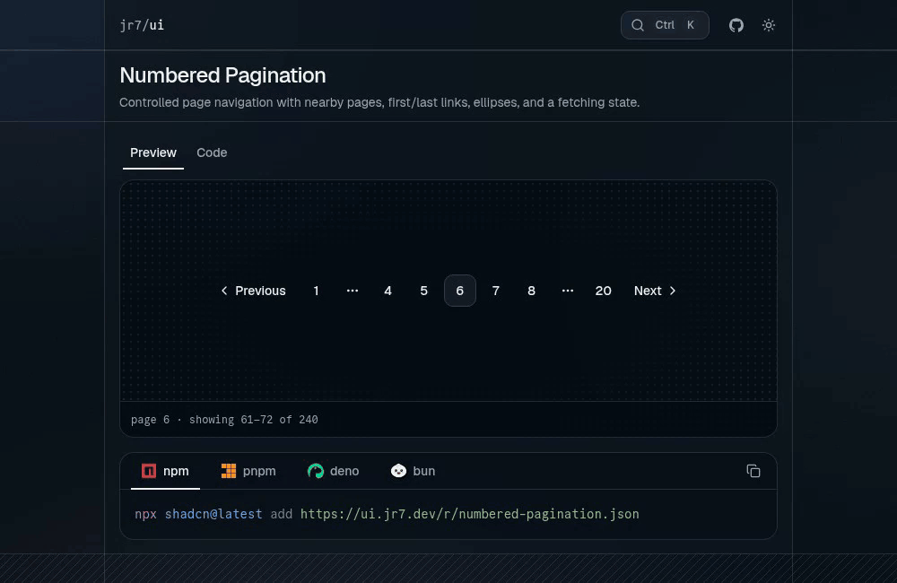
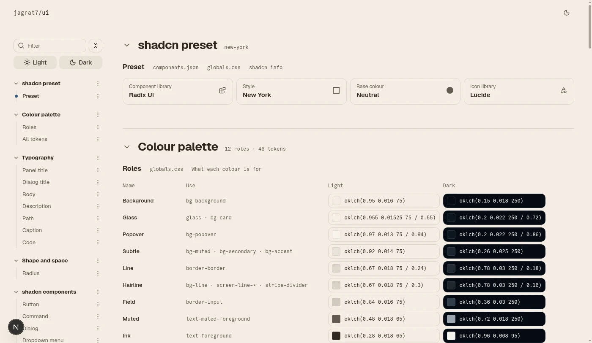

# jr7/ui

A shadcn registry of React components I struggled to find elsewhere.

[](https://ui.jr7.dev)

## Components

- [Loading button](#loading-button): shows a spinner and blocks repeat clicks during an async action.
- [Numbered pagination](#numbered-pagination): page navigation with nearby pages, first/last links, and ellipses.
- [Audio visualizer](#audio-visualizer): a mirrored waveform driven by a Web Audio analyser or frequency samples.
- [Error message](#error-message): an inline alert with a close button and optional auto-dismiss.
- [Scrollbar styled](#scrollbar-styled): a Tailwind utility for a thin scrollbar with a transparent track and a faint thumb that brightens on hover.
- [Design page](#design-page): a dev-only `/design` route showing your shadcn preset, palette, type, shape and every component in light and dark.

## Install

You need a React project already set up for shadcn. The CLI installs each component's npm and shadcn dependencies along with the source.

```bash
npx shadcn@latest add https://ui.jr7.dev/r/loading-button.json
```

Swap `loading-button` for `numbered-pagination`, `audio-visualizer`, `error-message`, or `scrollbar-styled`. The design page has its own commands: see [below](#design-page).

Or add the namespace to `components.json` once:

```json
{
  "registries": {
    "@jr7": "https://ui.jr7.dev/r/{name}.json"
  }
}
```

```bash
npx shadcn@latest add @jr7/loading-button
```

The examples below import from `@/components`. Change the paths if your alias differs.

### Loading button

Wraps the shadcn `Button`. While `isLoading` is true it swaps the children for a spinner and `loadingText`. You own the loading state.

```tsx
"use client"

import { useState } from "react"
import { LoadingButton } from "@/components/loading-button"

export function SaveButton({ onSave }: { onSave: () => Promise<void> }) {
  const [isLoading, setIsLoading] = useState(false)

  async function handleSave() {
    setIsLoading(true)
    try {
      await onSave()
    } finally {
      setIsLoading(false)
    }
  }

  return (
    <LoadingButton type="button" isLoading={isLoading} loadingText="Saving…" onClick={handleSave}>
      Save changes
    </LoadingButton>
  )
}
```

- `isLoading` (`boolean`, required): shows the spinner, disables the button, and sets `aria-busy`.
- `children` (`ReactNode`, required): idle content.
- `loadingText` (`string`, default `"Sending..."`): label next to the spinner.
- `isDisabled` (`boolean`, default `false`): extra disabled flag, OR'd with `isLoading` and `disabled`.
- Other shadcn `Button` props work except `asChild`. `variant` defaults to `"secondary"` and `type` to `"submit"`, so pass `type="button"` outside forms.

The spinner stops rotating under reduced motion.

[Source](registry/jr7/loading-button/loading-button.tsx) · [Demo](components/demos/loading-button.tsx)

### Numbered pagination

Renders previous/next, up to two pages on each side of the current one, first/last buttons outside that window, and ellipses for gaps. It doesn't fetch anything. You update the page and load the results.

```tsx
"use client"

import { useState } from "react"
import { NumberedPagination } from "@/components/numbered-pagination"

export function ResultsPagination() {
  const [page, setPage] = useState(1)

  return (
    <NumberedPagination page={page} totalResults={240} resultsPerPage={12} onPageChange={setPage} />
  )
}
```

- `page` (`number`, required): current page, 1-based.
- `totalResults` (`number`, required): total result count.
- `resultsPerPage` (`number`, required): page size. Page count is `ceil(totalResults / resultsPerPage)`, minimum 1.
- `onPageChange` (`(page: number) => void`, required): called with the requested page.
- `isFetching` (`boolean`, default `false`): disables navigation and sets `aria-busy`.
- `hasNextPage` (`boolean`, optional): `false` disables Next early. `true` can't push past the last page and doesn't affect the numbered buttons.
- Standard `<nav>` props work. `aria-label` defaults to `"Pagination"`.

The displayed page is floored and clamped to the valid range. Bad totals or page sizes fall back to one page. None of this calls `onPageChange`, so keep your own state in sync when the total changes.

For a custom UI, `getPaginationRange(page, totalResults, resultsPerPage)` returns the normalized `page`, `totalPages`, neighboring pages, and the first/last/ellipsis flags.

[Source](registry/jr7/numbered-pagination/numbered-pagination.tsx) · [Demo](components/demos/numbered-pagination.tsx)

### Audio visualizer

Pass a Web Audio `AnalyserNode` and it draws a mirrored waveform with `audvis`. Pass byte-frequency samples instead and it renders an SVG, no audio context needed.

```tsx
import { AudioVisualizer } from "@/components/audio-visualizer"

export function AudioPreview() {
  return (
    <AudioVisualizer
      isActive
      frequencyData={[40, 90, 150, 220, 180, 120, 80, 30]}
      height={48}
      ariaLabel="Sample audio frequency spectrum"
    />
  )
}
```

For live audio, pass the analyser from your player:

```tsx
<AudioVisualizer
  analyser={analyser}
  isActive={isPlaying}
  progress={duration > 0 ? currentTime / duration : undefined}
  ariaLabel="Playback progress"
/>
```

- `isActive` (`boolean`, required): when false, shows a flat dashed idle strip.
- `analyser` (`AnalyserNode | null`, optional): wins over `frequencyData` if both are set.
- `frequencyData` (`readonly number[] | Uint8Array`, optional): samples from 0 to 255. Out-of-range values are clamped, non-finite ones become 0.
- `progress` (`number`, optional): 0 to 1. Switches the role from `img` to `progressbar` and exposes the percentage through ARIA. It doesn't draw a progress indicator.
- `width` (`number`, default `680`): internal drawing width, which sets the bar count. The waveform still fills its container.
- `height` (`number`, default `24`): height in pixels. Minimums are 8px wide and 4px high.
- `color` (`string`, optional): any CSS color. Defaults to `text-primary` and follows theme changes.
- `className` (`string`, optional)
- `ariaLabel` (`string`, default `"Audio waveform"`)

Under reduced motion or with no input, it shows the idle strip.

It never requests the microphone, plays audio, or opens or closes an audio context. That's on you. The [demo](components/demos/audio-visualizer.tsx) uses an [`openMicrophone` helper](lib/microphone.ts) that doesn't ship with the component.

[Source](registry/jr7/audio-visualizer/audio-visualizer.tsx) · [Demo](components/demos/audio-visualizer.tsx)

### Error message

An inline alert with an icon and close button. Clearing the message hides it.

```tsx
"use client"

import { useState } from "react"
import { ErrorMessage } from "@/components/error-message"

export function ErrorExample() {
  const [message, setMessage] = useState<string | null>(null)

  return (
    <div>
      <ErrorMessage message={message} setMessage={setMessage} autoDismissTimeout={0} />
      <button type="button" onClick={() => setMessage("We couldn't save your changes.")}>
        Show error
      </button>
    </div>
  )
}
```

- `message` (`string | null`, required): `null` or `""` hides the alert.
- `setMessage` (`(message: string | null) => void`, required): called with `null` on close or timeout. A state setter works directly.
- `autoDismissTimeout` (`number`, default `5000`): ms before auto-dismiss. `0` or less disables it.
- `className` (`string`, optional)

The timer starts when the message appears, even if it's off-screen. Changing the message, timeout, or setter restarts it.

It uses `role="alert"`, labels the close button, and skips animations under reduced motion.

[Source](registry/jr7/error-message/error-message.tsx) · [Demo](components/demos/error-message.tsx)

### Scrollbar styled

A Tailwind utility, not a component. Installing it adds this to your `globals.css`:

```css
@utility scrollbar-styled {
  @apply scrollbar-thin scrollbar-thumb-border/40 scrollbar-track-transparent hover:scrollbar-thumb-border;
}
```

Put the class on any element that scrolls, including ones you don't render yourself, like a dialog or dropdown:

```tsx
<div className="scrollbar-styled h-64 overflow-y-auto">{/* … */}</div>

<DialogContent className="scrollbar-styled max-h-[80vh] overflow-y-auto" />
```

The scrollbar is thin, the track is transparent, and the thumb sits at 40% of your `border` colour until the pointer is over the element, when it goes to full strength. You still set the overflow yourself.

It needs Tailwind 4.3 or later, which added the [`scrollbar-width`](https://tailwindcss.com/docs/scrollbar-width) and [`scrollbar-color`](https://tailwindcss.com/docs/scrollbar-color) utilities it's built from. On older versions, the [`tailwind-scrollbar`](https://github.com/adoxography/tailwind-scrollbar) plugin provides the same class names. Don't use both, because they define the same classes.

[Demo](components/demos/scrollbar-styled.tsx)

### Design page

A `/design` route for development only. It reads your stylesheet, `components.json` and UI folder and shows the shadcn preset, every colour token, the type scale, radius, and each component in light and dark side by side. Each component's file name, and every file that uses it (the "N uses" menu), opens in your editor. Outside development the route answers 404 and none of its code is in the build.



Pick the item for your bundler:

```bash
# Next.js, App Router
npx shadcn@latest add https://ui.jr7.dev/r/design-page-next.json

# Vite with TanStack Router (TanStack Start included)
npx shadcn@latest add https://ui.jr7.dev/r/design-page-vite.json
```

Both add a `design/` folder (under `src/` if you have one), the route, `scripts/design-preset.ts`, the `Sortable` component, and the shadcn `button` and `dropdown-menu`. Then:

1. Point `design/sources.server.ts` (Next.js) or `design/sources.ts` (Vite) at your stylesheet and folders. The defaults are `app/globals.css`, `components/ui`, and `src/app/globals.css` for Vite.
2. Set `OUT` in `scripts/design-preset.ts` to where `shadcn-preset.gen.json` is, and run it: `bun scripts/design-preset.ts`.
3. Fill in `design/project.tsx`: name, logo, colour roles, type styles.
4. Write a `design/demos/<name>.demo.tsx` for each file in your UI folder and for your own components worth showing. The page lists the components that have none.

To update the page later without touching your own files (`project.tsx`, `ui.ts`, the sources, the demos):

```bash
npx shadcn@latest add https://ui.jr7.dev/r/design-page.json --overwrite
```

It can't place itself in a monorepo whose UI lives in its own package: the files land in the app, but their imports still say `@/components/ui/...`, so change those to your UI package. The Vite item's route is for TanStack Router's file routes; with another router, write the route yourself (lazy-load `design/index.tsx` behind `import.meta.env.DEV`).

[Shared page files](design) · [Starter files](registry/jr7/design-page)

## Development

```bash
pnpm install
pnpm dev
```

Components live in [`registry/jr7`](registry/jr7) and their metadata in [`registry.json`](registry.json). Run `pnpm registry:build` after editing one to regenerate the JSON. `pnpm build` does that and builds the site.

Page views go to Vercel Web Analytics and, when `NEXT_PUBLIC_WATCHTOWER_WEBSITE_ID` is set, to Watchtower (self-hosted Umami). It's read at build time.

## Credits

- [chanhdai.com](https://github.com/ncdai/chanhdai.com) (MIT): panel layout adapted from here. The page dividers and circular theme reveal were inspired by it.
- [VengeanceUI](https://github.com/Ashutoshx7/VengeanceUI) (MIT): the package manager picker.
- [shadcn/ui](https://ui.shadcn.com): base components and registry tooling.
- Commit Mono by Eigil Nikolajsen (SIL OFL 1.1): the monospace font. [License](app/fonts/CommitMono-LICENSE.txt).
